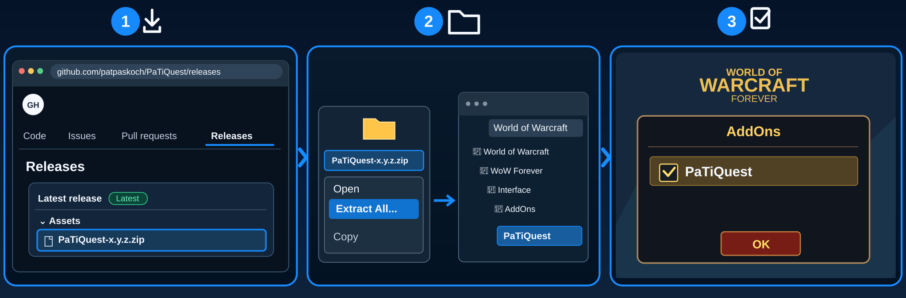

# PaTiQuest

## Install

**📥 [Download PaTiQuest Beta](https://github.com/patpaskoch/PaTiQuest/releases/download/v0.1.0-beta.1/PaTiQuest-0.1.0-beta.1.zip)** · [Installation guide](#installation)

*Installation-test preview — not yet a stable release.*

## What is PaTiQuest?

**Your quest. Your next objective. Right in sight.**

Keep your eyes on the adventure, not buried in the quest log. PaTiQuest gives the quest you've selected and its objectives a clean little space on your screen — so you always know what you're working toward.

## Features

- **Selected quest at a glance:** See the quest you're following.
- **Clear objectives:** Keep your next steps visible while playing.
- **No guessing:** Helpful feedback when no quest is selected.
- **Your screen, your way:** Move, resize or collapse the window.

## Installation

1. 📥 **Download** – Open [GitHub Releases](https://github.com/patpaskoch/PaTiQuest/releases) and download the `PaTiQuest-<version>.zip` file under **Assets** (not **Source code (zip)**).
2. 📂 **Extract & Copy** – Right-click the ZIP, select **Extract All**, then copy the extracted `PaTiQuest` folder into the WoW Forever client's `Interface/AddOns/` folder. No renaming is needed.
3. ☑️ **Enable in Game** – Start WoW, open the **AddOns** menu at character selection, tick **PaTiQuest**, and click **OK**.

## Getting Started

- Select a quest in your quest log — PaTiQuest shows it
- `/phq test` shows an example quest

## Settings

`/phq settings` or ••• → Settings: language, scale, window lock.
- **Window:** panel opacity (30–100 %)

## Important notes

> **Installation-test beta available:** [Download the current ZIP from Releases](https://github.com/patpaskoch/PaTiQuest/releases). This is an unverified preview for testing the installation, not a stable release.

> Status: 0.1.0, in development, not yet stable. Not yet tested in game since the rework.

## PaTiSuite

This addon is part of the **PaTiSuite** — a collection of small addons for World of Warcraft: Forever.
Each one is installed on its own and works on its own; none of them is needed by another.

- [PaTiSuite](https://github.com/patpaskoch/PaTiSuite) – optional control panel to show and hide the PaTi windows
- [PaTiHeal](https://github.com/patpaskoch/PaTiHeal) – healing: party frames, heal target, click casting, HoTs, dispels
- [PaTiAuras](https://github.com/patpaskoch/PaTiAuras) – buffs, procs, tracking, group buffs and weapon imbues
- [PaTiAggro](https://github.com/patpaskoch/PaTiAggro) – aggro for tank, healer and damage (formerly PaTiTank)
- [PaTiRota](https://github.com/patpaskoch/PaTiRota) – your own skill priority with cooldowns and fixed cast buttons
- [PaTiGroup](https://github.com/patpaskoch/PaTiGroup) – party awareness: tank, healer, roles and the tank's target
- [PaTiLead](https://github.com/patpaskoch/PaTiLead) – lead the group: raid markers, ready check and pull timer
- **PaTiQuest** – selected quest and its objectives *(this addon)*
- [PaTiDungeon](https://github.com/patpaskoch/PaTiDungeon) – instance, group and combat status
- [PaTiSocial](https://github.com/patpaskoch/PaTiSocial) – "Party Social": quick emote and message buttons
- [PaTiAlerts](https://github.com/patpaskoch/PaTiAlerts) – one window for open problems

### Goes well with (optional)

- [PaTiDungeon](https://github.com/patpaskoch/PaTiDungeon) – instance, group and combat status — a fitting companion while questing in groups
- [PaTiSuite](https://github.com/patpaskoch/PaTiSuite) – shows and hides this window together with the other PaTi windows

## Commands

`/phq` or `/patiquest` — alone: show/hide · `settings` · `test` · `show` · `hide` · `lock` · `unlock` ·
`reset` (position) · `debug` · `version`

## Known limitations

- Only the selected quest, no quest list.

## Development

Architecture, tests and engineering rules of the suite: [PaTiAdmin](https://github.com/patpaskoch/PaTiAdmin). PaTiAdmin is not a WoW addon — players do not install it. The shared UI code (PaTiShared) is already embedded in this addon's `Shared/` folder; there is nothing extra to install.

## License

MIT — see [LICENSE](LICENSE). Copyright (c) 2026 Patrick Koch.
